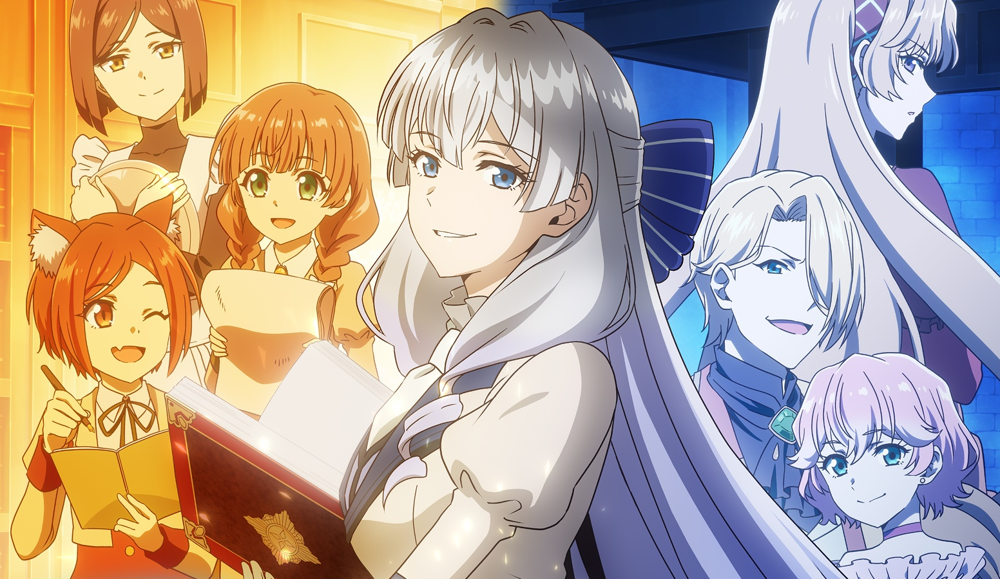

<div align="center">

  <!-- Header Banner -->
  

  <br/><br/>

  <!-- Dynamic Typing Header -->
  <a href="https://git.io/typing-svg">
    
  </a>

  <p align="center">
    <i>"Transforming knowledge into mastery, and logic into art."</i> 🪄
  </p>

  <!-- Badges Row -->
  <p align="center">
    <a href="https://github.com/Licee06">
      
    </a>
    <a href="https://dinus.ac.id/">
      
    </a>
    
    
  </p>

</div>

---

### 🌸 About Me

```python
class Licee06:
    def __init__(self):
        self.name = "Fico Aldi Saputro"
        self.alias = "Licee06"
        self.role = "Computer Science Student & Developer"
        self.university = "Universitas Dian Nuswantoro (UDINUS)"
        self.location = "Semarang, Central Java, Indonesia"
        self.email = "ficosaputro@gmail.com"
        self.theme_affinity = "Elizabeth Leiston (Buchigire Reijou)"

    def current_quest(self):
        return [
            "Deepening C++ & Systems Architecture ⚔️",
            "Building Scalable Backend Systems & APIs 🌐",
            "Exploring Data Structures & Competitive Logic 🧠"
        ]

    def grimoire_motto(self):
        return "Write clean, resilient code that stands the test of time."

me = Licee06()
print(f"✨ Initialized {me.name} ({me.alias}) from {me.university}!")
```

- 🎓 **Undergraduate Student** majoring in **Computer Science / Informatics** at **Universitas Dian Nuswantoro (UDINUS)**.
- 💻 Passionate about **Software Development**, **Backend Engineering**, and **C++ / System Programming**.
- 🛠️ Actively exploring robust backend architectures, algorithmic solutions, and modern tech stacks.
- 💜 Anime & Aesthetic enthusiast with a love for dark-mode, purple neon, and fantasy lore.
- ⚡ **Fun Fact:** Just like Elizabeth Leiston mastering the Seven Grimoires, I treat programming languages as spellbooks for solving complex puzzles!

---

### 🔮 Weapons of Choice (Tech Arsenal)

<div align="center">
  <p><b>Languages & Core Systems</b></p>
  <a href="https://skillicons.dev">
    
  </a>
  <br/><br/>
  <p><b>Frameworks, Tools & Environment</b></p>
  <a href="https://skillicons.dev">
    
  </a>
</div>

---

### 📊 Grimoire Analytics & Activity

<div align="center">
  <table border="0">
    <tr>
      <td align="center" valign="middle">
        
      </td>
      <td align="center" valign="middle">
        
      </td>
    </tr>
    <tr>
      <td colspan="2" align="center" valign="middle">
        <br/>
        
      </td>
    </tr>
  </table>
</div>

---

### 🌐 Connect With Me

<div align="center">

  <a href="mailto:ficosaputro@gmail.com">
    
  </a>
  &nbsp;
  <a href="https://www.tiktok.com/@chiroyw" target="_blank">
    
  </a>
  &nbsp;
  <a href="https://discord.gg/qa4uqfq" target="_blank">
    
  </a>
  &nbsp;
  <a href="https://discord.gg/nx8hU6pBrZ" target="_blank">
    
  </a>
  &nbsp;
  <a href="https://github.com/Licee06" target="_blank">
    
  </a>

</div>

<br/>

<div align="center">
  
</div>
